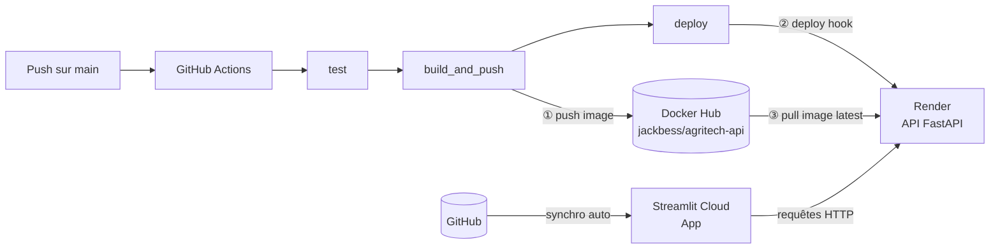
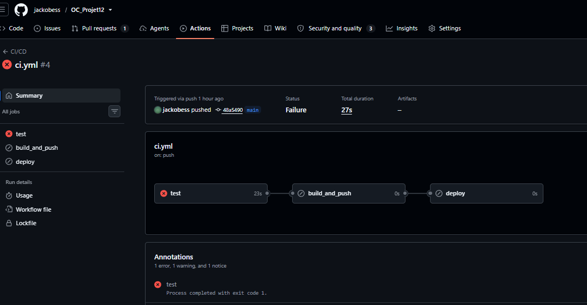
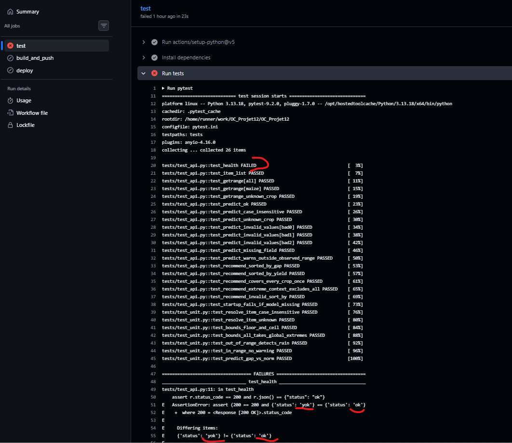
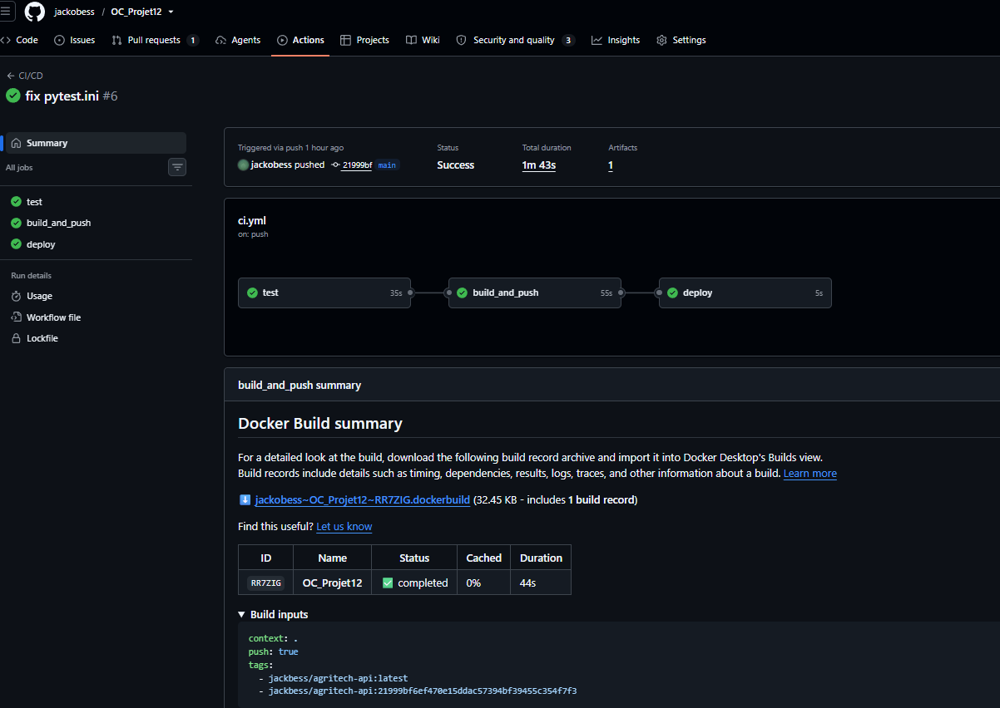
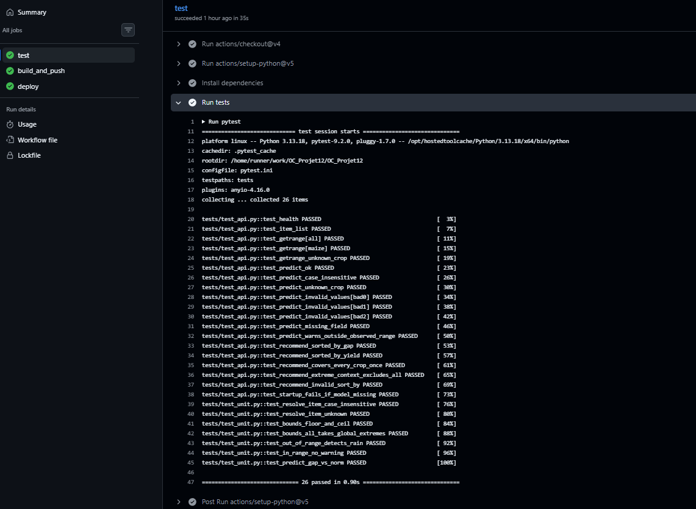
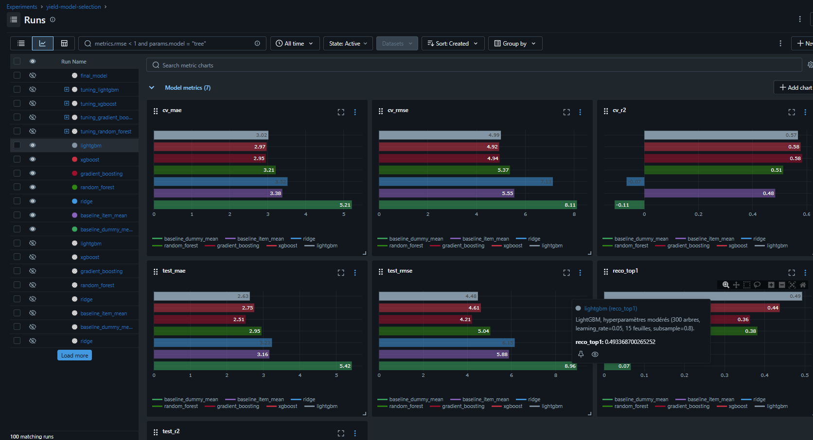
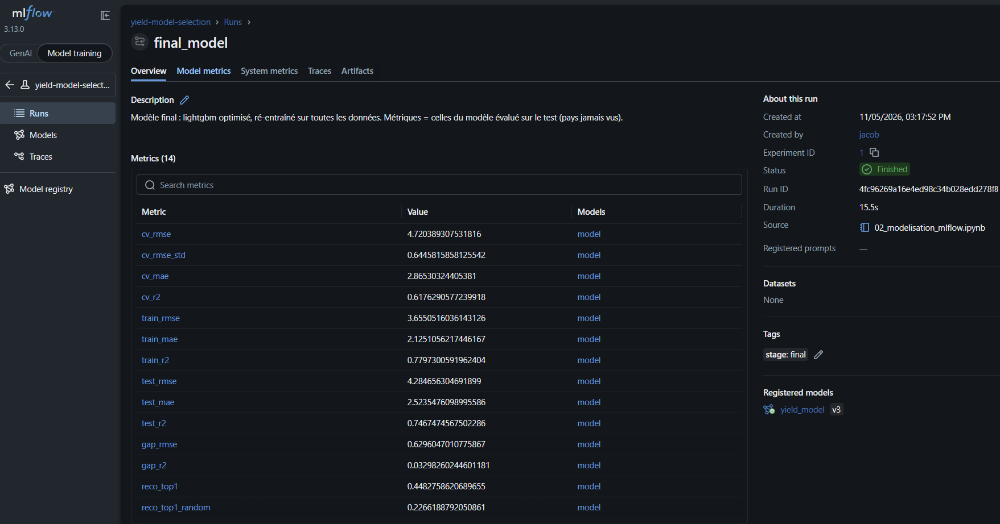
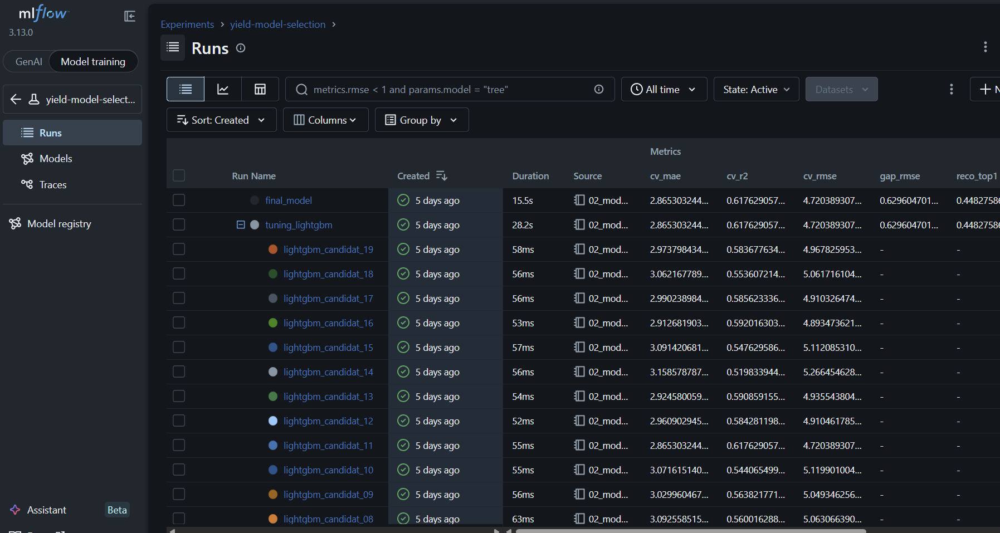

# Agritech Answers - Prédiction & recommandation de rendement

[](https://github.com/jackobess/OC_Projet12/actions/workflows/ci.yml)

Application web d'aide à la décision pour agriculteurs :

- **Prédiction** : pour une culture et des conditions de parcelle (pluie, température, pesticides), estimation du rendement (t/ha).
- **Recommandation** : pour des conditions données, classement de toutes les cultures possibles.

| Composant | Techno | URL |
|---|---|---|
| API | FastAPI (Docker, hébergée sur Render) | https://agritech-api-latest.onrender.com/docs |
| Front | Streamlit Community Cloud | https://ocprojet12-agritech-yield.streamlit.app/ |

> L'API est sur l'offre gratuite de Render : la première requête après une période d'inactivité peut prendre 30 à 50 s (cold start).

## Architecture



## Structure du repo

```
├── .github/workflows/ci.yml   # pipeline CI/CD
├── config.yaml                # configuration centralisée du pipeline d'entraînement
├── run_pipeline.py            # preprocessing -> entraînement -> évaluation
├── Dockerfile                 # image de l'API
├── pytest.ini
├── data/                      # données brutes et dataset consolidé
├── models/yield_model.joblib  # modèle entraîné embarqué dans l'image
├── notebooks/                 # EDA et modélisation (MLflow)
├── src/
│   ├── api/                   # API FastAPI (main.py, requirements.txt)
│   ├── app/                   # front Streamlit (app.py, requirements.txt)
│   └── preprocessing/         # preprocess.py, train.py, evaluate.py
└── tests/                     # tests unitaires + tests d'intégration de l'API
```

## API

| Endpoint | Rôle |
|---|---|
| `GET /health` | Vérification de l'état du service |
| `GET /getitemlist` | Liste des cultures |
| `GET /getrange?item=maize` | Plages observées (pluie, température, pesticides) pour une culture, ou `all` |
| `POST /predict` | Rendement prédit pour une culture |
| `POST /recommend` | Classement de toutes les cultures compatibles |

Exemples :

```bash
curl -X POST https://agritech-api-latest.onrender.com/predict \
  -H "Content-Type: application/json" \
  -d '{"item": "Maize", "rain_mm": 1000, "temp_c": 15, "pest_kg_ha": 2}'

curl -X POST https://agritech-api-latest.onrender.com/recommend \
  -H "Content-Type: application/json" \
  -d '{"rain_mm": 1000, "temp_c": 15, "pest_kg_ha": 2, "sort_by": "ecart_vs_norme"}'
```

`sort_by` : `ecart_vs_norme` (défaut, % vs rendement moyen de la culture) ou `rendement` (t/ha brut).
Les cultures dont la plage observée de pluie/température ne couvre pas la saisie sont listées dans `excluded`.

## Lancer en local

**Avec Docker**

```bash
docker run -p 8000:8000 jackbess/agritech-api:latest
# docs : http://localhost:8000/docs
```

**Sans Docker**

```bash
pip install -r src/api/requirements.txt
uvicorn src.api.main:app --reload
```

**Tests**

```bash
pip install -r tests/requirements.txt
pytest
```

La configuration de pytest (`testpaths`, `pythonpath`, options) est dans `pytest.ini`.

## CI/CD

Workflow : [`.github/workflows/ci.yml`](.github/workflows/ci.yml)

### Triggers

| Événement | Condition |
|---|---|
| `push` sur `main` | uniquement si un de ces chemins change : `src/api/**`, `models/**`, `Dockerfile`, `tests/**`, `pytest.ini`, `.github/workflows/ci.yml` |
| `workflow_dispatch` | lancement manuel depuis l'onglet Actions (le filtre de chemins est ignoré) |

### Jobs

Les jobs s'enchaînent via `needs` : si un job échoue, les suivants sont **skipped**.

| Job | Rôle | Détails |
|---|---|---|
| `test` | Tests de l'API | Python 3.13, installation de `tests/requirements.txt`, `pytest`. Tests unitaires (`tests/test_unit.py`, faux modèle) et tests d'intégration (`tests/test_api.py`, `TestClient` FastAPI avec le vrai modèle). |
| `build_and_push` | Construction et publication de l'image | Connexion à Docker Hub, build du `Dockerfile`, push de `jackbess/agritech-api` avec deux tags : `latest` et le SHA du commit. |
| `deploy` | Déploiement | Appel du *deploy hook* Render, qui redéploie l'image `latest`. |

### Secrets et variables GitHub

| Nom | Type |
|---|---|
| `DOCKERHUB_USERNAME`, `DOCKERHUB_REPO` | Variables |
| `DOCKERHUB_TOKEN` (token d'accès, pas le mot de passe), `RENDER_DEPLOY_HOOK` | Secrets |

Aucun secret n'est écrit dans le dépôt.

### Robustesse et échecs

- Un test rouge bloque le build et le déploiement (les deux jobs passent en *skipped*) : aucune image cassée n'est publiée.
- `test_startup_fails_if_model_missing` vérifie que l'API refuse de démarrer, avec une erreur claire, si le fichier modèle est absent.
- Notification d'échec : e-mail GitHub par défaut. Le détail des erreurs est dans les logs du run (`pytest --tb=short`).
- Rollback : chaque image est aussi taguée avec le SHA du commit et reste disponible sur Docker Hub, ce qui permet de redéployer manuellement une version antérieure 
  (le hook Render automatique déploie tjrs `latest`).

#### Exemple de run en échec (test volontairement cassé):




#### Exemple de run réussi:




### Limites connues

- Le front Streamlit est resynchronisé par Streamlit Cloud à chaque push sur la branche connectée, indépendamment du résultat des tests.
- Le deploy hook Render redéploie `latest` (pas de version pinnée sur le SHA) et ne vérifie pas que l'API répond après le déploiement.

## Suivi des expérimentations (MLflow)

Les expérimentations d'entraînement (modèles, hyperparamètres, métriques RMSE / R²) sont tracées avec MLflow (voir `notebooks/02_modelisation_mlflow.ipynb`).

```bash
mlflow ui --backend-store-uri sqlite:///mlflow.db --workers 1
```







